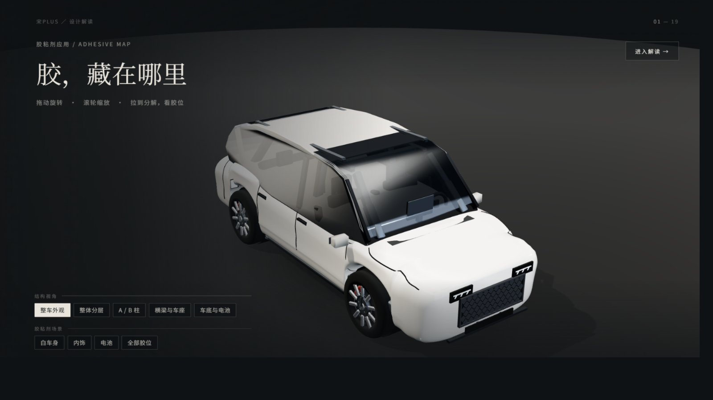

# design-deck-render

> 把一份结构化内容（大纲 / Markdown / JSON）渲染成 **1600×900、深色「影像档案」风格的单文件 HTML 演示**。

一个 AI Skill：给它标题、逐页文案和图片，它输出一个双击就能打开、断网也能看、能直接转发出去的 `index.html`。
本项目复刻的是一套**视觉与排版语言**（版式、字阶、留白、动效节奏），不是搬运任何页面。

---

## ⚠️ 免责声明

- 本项目**不是官方项目**，与任何被参考的第三方网站、平台、品牌**没有隶属、合作或背书关系**。
- 本项目**不包含**被参考页面的源码、图片、样式表、字体文件、接口地址或任何私有资源；
  仓库内的全部代码、文档与示例文案均为独立编写。运行时所需的 URL、ID、参数**一律由使用者自行传入**，
  代码与文档中不保存任何 sharecode、shareId、token 或内部接口。
- 被参考页面的视觉风格、商标、图片及原创设计，**版权归各自权利人所有**。
  若权利人认为本项目存在不当引用，请通过 [SECURITY.md](SECURITY.md) 中的联系方式提出，我们会及时处理。
- 使用本项目生成的任何内容，其**文案、图片、数据的版权与合规责任由使用者自行承担**。

---

## 这是什么 / 解决什么问题

把"做一份好看的演示稿"从**设计问题**降级成**内容问题**：

| 常见困境 | 本项目的做法 |
|---|---|
| 用 PPT 排，做不出路径生长、图版擦入这类节奏 | 用 HTML + CSS 动效，舞台固定、等比缩放，一版到底 |
| 用网页做，发出去对方打不开（缺文件、缺依赖、要装环境） | 输出**单文件**：零子资源请求，`file://` 双击可开、断网可开 |
| 每页都想讲三件事，观众一件都没记住 | 强制"一页一个判断、一个主运动"的版式约束 |
| 深色稿子在不同屏幕上一会儿好看一会儿糊 | 固定设计令牌（底色/字色/强调色/字阶/行高），不即兴发挥 |

---

## 能力说明与触发词

**能力**

- 10 种逐页版式原型：封面、主张（引文页）、图文分栏 + 原生刻度尺、全幅图版 + 路径描线、
  编号锚点（落在图上的零件标签）、构件阶梯（大中小错位 + 缺图占位卡）、区间条、时间线、代价页、收束五条。
- 四个动效原语，一页只用其中一个当主运动：`rise`（浮现）/ `draw`（路径生长）/ `wipe`（图版擦入）/ `pop`（延迟出现）。
- 单文件构建：把 CSS、JS、图片（base64）内联，产物不含任何子资源引用。
- 深链与排练：`?p=6` 直达第 6 页；键盘 `←/→/空格/F/A/Home/End`；点击左右半屏翻页；触屏左右滑。
- 静态终态：`prefers-reduced-motion` 下直接给终态（同时是无头截图校验的可靠通道）。
- 主题可覆盖：底色、字色、强调色、字族四组令牌，改 `:root` 即可，不动版式。

**触发词**

`设计解读`、`动态演示`、`HTML 演示`、`单文件演示`、`放映稿`、`路演稿`、`image-archive deck`、
`render my outline into a deck`、`turn notes into slides`、`design reading deck`

> 不适用范围：需要 `.pptx` 交付、需要多人协作编辑、纯数据报表。这些场景请用专用工具。

---

## 效果预览



> **版权说明**：上图是**被复刻效果的第三方页面截图**，仅作"效果参考"引用，用于说明本 Skill 的目标渲染语言；
> 其画面、车型影像与界面设计的权利归原方所有，**不在本项目的 MIT 授权范围内**。
> 本仓库不包含该页面的源码、样式表、脚本、接口或原始素材。
> 若你希望仓库完全不含第三方画面，把 `assets/preview.png` 换成你自己产出的截图即可，README 无需改动。

---

## 安装与使用

### 1. 安装为 Skill

```bash
git clone <THIS_REPO> design-deck-render

# 放进你所用的 Agent 技能目录（二选一）
mkdir -p ~/.claude/skills/design-deck-render       # Claude Code
# mkdir -p ~/.workbuddy/skills/design-deck-render  # WorkBuddy
cp design-deck-render/SKILL.md ~/.claude/skills/design-deck-render/
```

Windows（管理员 PowerShell）：

```powershell
git clone <THIS_REPO> design-deck-render
$dest = "$env:USERPROFILE\.claude\skills\design-deck-render"
New-Item -ItemType Directory -Force $dest
Copy-Item .\design-deck-render\SKILL.md $dest
```

### 2. 使用

准备两样东西，然后一句话触发：

```
1) 内容：一份逐页文案（Markdown 或 JSON 都行），每页含：标题 / 一句判断 / 正文（≤40 字）/ 若有配图写明文件名
2) 图片（可选）：放在 img/ 下，webp 优先，宽度 ≤1600px
```

对话里说：

```
用 design-deck-render 把 ./deck.md 渲染成演示稿，标题「用姿态读一台车」，19 页，输出 ./out/index.html
```

运行时参数由**你**传入（标题、页数、内容路径、图片目录、输出路径、强调色），Skill 内不保存任何地址或 ID。

### 3. 产物

```
out/index.html     ← 单文件，双击即放；可直接发微信/邮件
```

---

## 依赖说明

| 项 | 是否必需 | 说明 |
|---|---|---|
| 现代浏览器（Chrome / Edge / Safari 近两年版本） | 必需 | 放映端。无需任何插件 |
| Node.js ≥ 18 | 可选 | 仅用于构建与无头截图脚本；不装也能手工内联 |
| Noto Serif SC / Noto Sans SC（或思源宋/黑、PingFang SC） | 可选 | 缺失时自动降级到系统衬线/无衬线，版式不塌但气质会变 |
| 网络 | **不需要** | 产物零外部请求；构建与放映全程可离线 |

不引入任何前端框架、CSS 库、字体 CDN、统计脚本。

---

## 已知限制

- **固定 16:9 横版**。竖屏手机不重排版式，只给"请横置手机"引导。
- **不做图片生成**。配图需你自备（或交给其他工具生成）；生成图不得冒充实拍证据。
- **不做数据可视化引擎**。只提供"刻度尺 / 区间条 / 时间线"三种原生图形原语，复杂图表请先出图。
- **不导出 PPTX / PDF**。要 PPT 请用 PPT 专用流程。
- **字体决定气质**。缺思源系字体会降级，标题的宋体质感会明显下降。
- **无编辑器**。改内容＝改源文件再重新构建，不提供所见即所得界面。

---

## 开源协议与贡献

- 协议：[MIT](LICENSE)
- 贡献指南：[CONTRIBUTING.md](CONTRIBUTING.md)
- 行为准则：[CODE_OF_CONDUCT.md](CODE_OF_CONDUCT.md)
- 安全问题：[SECURITY.md](SECURITY.md)
- 变更记录：[CHANGELOG.md](CHANGELOG.md)

提交前请确认：不含第三方页面源码/图片/样式、不含任何真实 sharecode / shareId / token / 内部接口。
